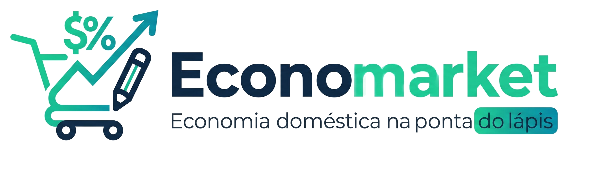

<div align="center">



# Economarket

**Comparador inteligente de preços de supermercado, com calculadoras financeiras, lista de compras e controle de orçamento.**


**[🔗 Acessar o app online](https://SEU-PROJETO.vercel.app)** · Instalável no celular e no computador (PWA)

</div>

---

## Sobre o projeto

O **Economarket** ajuda quem está no supermercado (ou planejando a ida) a descobrir onde cada produto sai mais barato. A aplicação compara cotações entre redes como Atacadão, Assaí, Extra e Carrefour, mostra a diferença entre o menor e o maior preço, destaca as maiores economias da semana e reúne ferramentas de apoio como calculadoras, lista de compras e um orçamento limite para a sacola.

O projeto nasceu como parte de uma imersão em desenvolvimento com IA, e cada ferramenta corresponde a um desafio das aulas, documentado dentro do próprio app na aba **Aulas**.

## Funcionalidades

**Comparador de preços.** Cadastre ofertas de produtos por supermercado, filtre por categoria e rede, e veja o preço mais baixo, o mais alto, a média e a porcentagem de economia de cada item. O app já vem com uma base de demonstração com dezenas de produtos do dia a dia.

**Calculadora simples.** Quatro operações com visor interativo, avaliador de expressões próprio (sem `eval`) e fita de histórico dos cálculos recentes.

**Calculadora aprimorada.** Comparador de preço por peso ou volume (R$/kg e R$/L) para descobrir qual embalagem compensa mais, simulador de promoções "Leve X, Pague Y" e cálculo de desconto percentual, como o de clube ou pagamento à vista.

**Lista de compras.** Itens marcados como concluídos ficam com destaque visual e texto riscado, e tudo é salvo automaticamente no navegador.

**Orçamento limite (sacola controlada).** Defina um teto de gastos, adicione itens com quantidade e preço e acompanhe o saldo restante em tempo real, com alertas por cor: verde abaixo de 80% do limite, amarelo entre 80% e 99,9% e vermelho a partir de 100%.

**Aulas.** Página com a trajetória da imersão e os cartões de cada entrega.

## Tecnologias

O app é uma **SPA estática e modular**, feita apenas com HTML, CSS e JavaScript puro, sem framework, sem build e sem Node. O roteamento é feito por hash na URL (`#home`, `#todo-list` etc.) e os dados ficam no `localStorage` do navegador, então nada sai do seu computador. O projeto também é um **PWA**, ou seja, pode ser instalado como app e funciona offline.

## Instalar como app (PWA)

O Economarket pode ser instalado no aparelho, com ícone próprio, abertura em tela cheia e funcionamento offline, o que ajuda dentro do mercado quando o sinal é fraco.

**Android (Chrome):** abra o site, toque no menu (⋮) e escolha *Instalar app* ou *Adicionar à tela inicial*.

**iPhone (Safari):** abra o site, toque no botão de compartilhar e escolha *Adicionar à Tela de Início*.

**Computador (Chrome ou Edge):** clique no ícone de instalação que aparece na barra de endereço.

## Como executar

Não há nada para instalar. Basta clonar o repositório e abrir o `index.html` no navegador:

```bash
git clone https://github.com/SEU-USUARIO/economarket.git
cd economarket
```

Se preferir servir os arquivos por um servidor local, qualquer um serve, por exemplo:

```bash
python -m http.server 8000
```

E depois acesse `http://localhost:8000`. Abrir o `index.html` direto no navegador também funciona, mas o modo offline e a instalação como app só ficam disponíveis quando o site é servido por `http://localhost` ou por `https://`.

## Estrutura de pastas

```
economarket/
├── index.html              # Página única com todas as seções
├── manifest.json           # Configuração do app instalável (PWA)
├── sw.js                   # Service worker (cache e modo offline)
├── assets/                 # Logo e imagens
├── icons/                  # Ícones do app em vários tamanhos
├── css/                    # Estilos modulares (um arquivo por tela/componente)
├── js/
│   ├── components/         # Home, calculadoras, lista de compras, orçamento, aulas...
│   └── utils/              # Roteador, persistência (localStorage), avaliador matemático, app.js
```

## Persistência de dados

Todas as informações (ofertas, lista de compras, histórico de cálculos e orçamento) ficam salvas no `localStorage`, com chaves prefixadas por `economarket_`. Para restaurar o estado inicial, limpe os dados do site nas configurações do navegador.

## Atualizando o app

O service worker guarda os arquivos em cache. Ao alterar qualquer arquivo do projeto, aumente o número de `CACHE_NAME` em `sw.js` (por exemplo, de `economarket-v1` para `economarket-v2`) para que os usuários recebam a versão nova.

## Contribuindo

Sugestões e melhorias são bem-vindas. Abra uma *issue* descrevendo a ideia ou envie um *pull request*.

## Licença

Defina aqui a licença do projeto (por exemplo, MIT).
